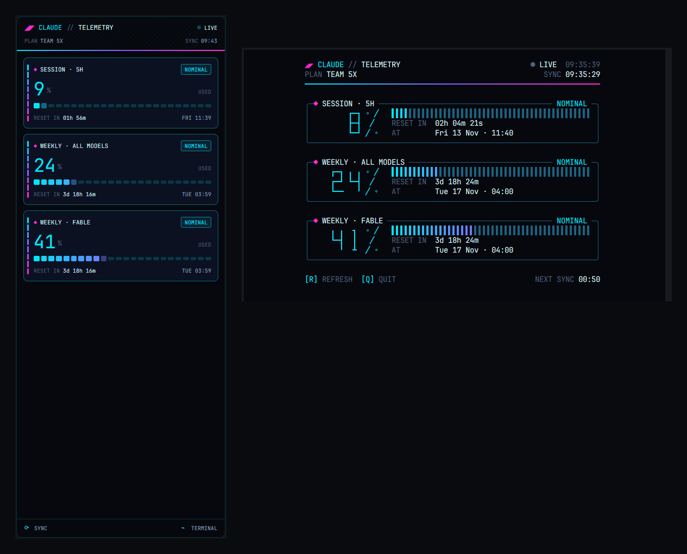

# Claude Usage

Claude's plan limits as telemetry for [Herdr Desktop](https://herdr.dev/): the current session, the week across all models, and the week of one model (Fable by default), each with the time to its reset. It draws in a sidebar panel, or runs as a TUI in a terminal pane, as you choose.



- **Session · 5h**, **Weekly · all models** and **Weekly · Fable**, each as a big percentage, a segmented meter and a countdown to the reset with its local time.
- **Levels:** Nominal under 75%, Elevated from 75%, Critical from 90% or when Anthropic marks the limit itself; the number and meter change colour with it.
- **Two places to show it:** `display.mode` is `panel` (the default) or `terminal`. In terminal mode the toolbar button starts the TUI in a split beside the focused pane (or focuses it if it's already running) and puts the panel away.
- **Neon or theme:** a fixed cyan-to-magenta look on near black, or the same roles in Herdr's theme colours (the terminal's own 16 colours in the TUI).
- The TUI runs in any terminal, inside Herdr or not: `~/.config/herdr-app/mods/claude-usage/bin/claude-usage tui`.
- **A neon theme for all of Herdr** comes with it: the same cyan, violet and magenta on deep blue-black for terminals, sidebars, tabs and panels.

## Install only this mod

Copy this prompt into your Herdr agent:

> Read ~/.config/herdr-app/AGENTS.md, then add this mod: https://github.com/munza/herdr-mods/tree/main/claude-usage

Requirements: **Go 1.23+** to run the installer and build the helper, and **Claude Code logged in with a Claude subscription** (Pro, Max, Team or Enterprise) on this computer. API keys have no plan limits to show.

Read [RECIPE.md](RECIPE.md) and the source before installing. The mod **reads Claude Code's login** from `~/.claude/.credentials.json` (or `$CLAUDE_CONFIG_DIR`; on macOS the keychain item `Claude Code-credentials` when there's no file), **sends its access token to `api.anthropic.com/api/oauth/usage`** and nowhere else, and **runs its own helper** from `bin/`. It never renews the login, since that would replace the refresh token Claude Code holds: when the token has expired, the panel says to start Claude Code once. It writes nothing.

From this folder:

```sh
go -C helper run ./install          # first install
go -C helper run ./install --update # later
```

The installer builds the helper to `mods/claude-usage/bin/claude-usage`, copies only `mods/claude-usage/` to `~/.config/herdr-app/mods/claude-usage/`, and runs `herdr-app check`. It doesn't edit layouts or keys.

### Place the panel

The manifest has `place: none`, so add it to a layout you own, for example as a child of the right-hand panel's stack:

```json
{ "id": "claude-usage", "type": "block", "content": { "mod": "claude-usage" } }
```

With Better Tabs, a button opens it (`target` is that block's layout ID). The same button serves terminal mode: showing the panel is what starts the TUI.

```json
{
  "id": "claude-usage",
  "label": "Claude Usage",
  "icon": "mods/claude-usage/icons/gauge.svg",
  "group": "panels",
  "action": { "type": "panel", "container": "panel", "stack": "panel-body", "target": "claude-usage" }
}
```

## The neon theme

`themes/neon.json` is a full Herdr theme in the panel's colours: a near-black terminal ground, 16 ANSI colours built on the same cyan (`ansi6`), magenta (`ansi5`), red and amber, a magenta cursor, violet selection, and every panel colour (chrome, surface, raised, border, cyan accent and buttons, status colours). Text keeps at least 7:1 contrast on every ground, and the tests check it.

The installer adds it to `~/.config/herdr-app/themes/` and keeps a copy you've edited. Pick **neon** in Settings' theme menu, or set it on the root of a layout you own, with a dark violet-to-blue gradient behind the cards if you like:

```json
{ "id": "root", "type": "row", "theme": "neon",
  "background": { "gradient": ["#0b0718", "#03070d"], "angle": 160 }, ... }
```

Panes framed with `"focus": { "width": 1, "color": "accent" }`, as Herdr's own layouts are, get a cyan border while they have the keyboard. With the theme on, the panel's `style.palette: "theme"` and the TUI's `--palette theme` look neon too.

The Better mods and the Branch panels in this repository follow it: while the neon theme is on, their panel headers (Files, Changes, PRs, Issues), Better Sidebar's Spaces and Agents strip and Better Config's title get this panel's hatched ground and gradient rule, and Better Tabs' bar gets the rule. Each carries the same small `neon.js`; with another theme they look as before.

## The TUI

```sh
claude-usage tui [--every 60s] [--model Fable] [--palette neon|theme]
claude-usage json [--model Fable]
```

`r` reads again, `q` or Ctrl-C quits. The countdowns tick each second; the endpoint is read every `--every`, never more often than every 30 seconds. It takes the whole terminal and draws compact cards when the terminal is short or narrow. `json` is one read, printed as JSON; the panel uses it.

## Commands

`claude-usage.refresh` reads again, and `claude-usage.terminal` starts or focuses the TUI. Commands reach copies that have been shown.

## Settings

[Better Config](../better-config/README.md) shows these with what each one does. By hand, add a `settings` block to the installed `mods/claude-usage/mod.json` with only what you change; it is kept across `--update`, and `mod.schema.json` beside it describes each one. The defaults:

```json
"settings": {
  "display": { "mode": "panel" },
  "refresh": { "every": "60s" },
  "model": "Fable",
  "style": { "palette": "neon" },
  "terminal": { "place": "right" }
}
```

`display.mode` is `panel` or `terminal`. `refresh.every` is how often the endpoint is read while the panel or TUI shows; under 30s counts as 30s, and a hidden panel doesn't read at all. `model` is the model whose weekly limit the third card shows, by the name Claude gives it; if your plan has no such limit, the card says which ones it has. `style.palette` is `neon` or `theme`. `terminal.place` is `right`, `down` or `tab`. Unknown keys and wrong types are reported in the panel and ignored.

## Development

```sh
node --test tests/*.test.cjs
(cd helper && go test ./... && go vet ./...)
go -C helper run ./install --update
herdr-app check "$HOME/.config/herdr-app/mods/claude-usage"
```

`mods/claude-usage/main.js` holds the panel's state, polling and the hand-off to the terminal; `model.js` says what the helper's answers mean and where the panel sits in a layout; `views/ui.js` is the look. `themes/neon.json` is the theme, and `tests/theme.test.cjs` checks its shape, its contrast and that it matches the panel's palette. `helper/usage.go` reads the login and the endpoint, `render.go` draws the TUI as plain strings (tested), and `term.go` runs it in a terminal.

The usage endpoint isn't a published API. Its `limits[]` list (`session`, `weekly_all`, and `weekly_scoped` per model) is what Claude Code's own `/usage` reads; the older `five_hour` and `seven_day` objects stand in when it's missing.

See [LICENSE](../LICENSE) and [NOTICE](../NOTICE) for attribution.
