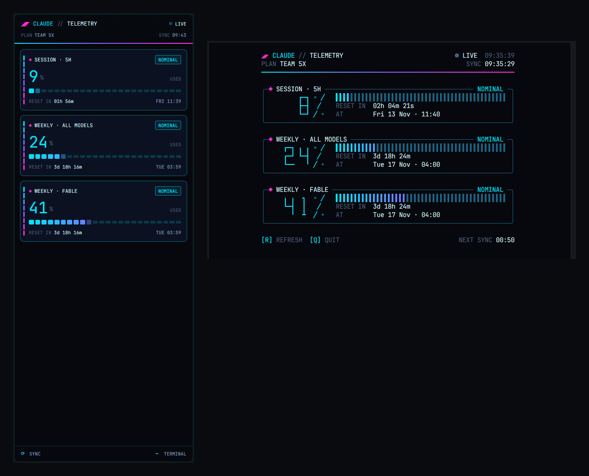

# Claude Usage

A panel, or a terminal TUI, that shows a person's Claude plan limits: the current session, the week across all models, and the week of one model (Fable by default), each with the time to its reset. Judge any addition by whether it helps someone see at a glance how much is left and when it comes back. It reads Claude Code's own login and Anthropic's usage endpoint, through a small Go helper.

## What you see

One framed sidebar panel, radius 10, all in the code font. In the default neon palette its ground is near black (`#07080d`) whatever the theme, with cyan `#00e5ff`, violet `#8b5cff` and magenta `#ff2bd6` as accents, amber for Elevated and red for Critical; `style.palette: "theme"` maps the same roles to `theme()`: background, raised, border, foreground, muted, dim, ansi6, ansi4, ansi5, ansi3, ansi1.

The header has `◢◤ CLAUDE // TELEMETRY` on a faint hatched ground, a breathing dot with the link state on the right (LIVE, SYNCING, STALE after a failed read with data still shown, OFFLINE with none, TERMINAL in terminal mode), then PLAN with the plan from the login (`TEAM 5X`, `MAX 20X`) and SYNC with the last read's time, over a 2px gradient rule.

Three cards follow, SESSION · 5H, WEEKLY · ALL MODELS and WEEKLY · FABLE (the model's name upper-cased), each with a spine down its left side: eight rounded 3px segments along the level's gradient, set 6px in and 12px from the top and bottom so they stay inside the card's radius (a painted gradient isn't clipped to rounded corners). A card's first line is a magenta ◆, the title, and a level tag on the right (NOMINAL, ELEVATED, CRITICAL, or NO SIGNAL). Then the percentage at 34px in the level's colour with a dim `%`, a meter of 24 segments filled along the level's gradient whose leading segment pulses, and RESET IN with the time left to the minute (`02h 04m`, `3d 18h 24m`) and the reset's local day and time on the right. A limit the answer lacks shows `--`, an empty meter and why (`NO FABLE LIMIT · HAS OPUS`). A failed read adds a red strip under the cards with what to do. A 34px footer holds SYNC (a spinner while reading) and TERMINAL.

In terminal mode the panel shows a TERMINAL MODE card with an OPEN TERMINAL action, though it's normally put away at once (below).

The TUI draws the same in a terminal: a header, a gradient rule, and three boxed cards with the percentage in big box-drawing digits, a meter of `▌` cells, RESET IN to the second and AT with the date and time, then `[R] REFRESH  [Q] QUIT` and NEXT SYNC. A short or narrow terminal gets three-row cards. `--palette theme` uses the terminal's 16 colours and its own ground.

## How it behaves

The helper's `json` command is the only reader: it reads `claudeAiOauth` from `~/.claude/.credentials.json` (`$CLAUDE_CONFIG_DIR` if set, the macOS keychain when there's no file), refuses an expired token without a request, and calls `GET https://api.anthropic.com/api/oauth/usage` with `anthropic-beta: oauth-2025-04-20`. From `limits[]` it takes `session`, `weekly_all` and the `weekly_scoped` entry whose `scope.model.display_name` matches the `model` setting (case aside); `five_hour` and `seven_day` stand in when `limits` is missing. Errors come back as `{error, kind}` with kind `login`, `expired`, `network` or `api`, and the panel gives advice for each. It never renews the token, since that would rotate the refresh token Claude Code holds.

The panel reads only while it is on screen (checked through `layout()` every 500ms, which costs no redraw) and only in panel mode, every `refresh.every` and never under 30 seconds. It redraws twice a minute for the countdowns; the pulses are native animation.

Herdr keeps a stack child unloaded until it first shows, so a toolbar command can't reach it. Terminal mode therefore treats coming on screen as the request: the panel finds the running TUI among `terminals()` by its foreground argv and focuses it with `pane.focus`, or starts one with `terminal.open {argv: [bin, "tui", ...], place}`, then selects another child of its stack and hides the stack's container, so the same Better Tabs panel button opens the TUI. Two copies loading together open one terminal. Quitting the TUI closes its pane.

## Built from

`mods/claude-usage/`: `main.js`, `model.js`, `settings.js` (shared between this repo's mods), `mod.json` (`place: none`, title Claude Usage), `mod.schema.json` (its settings with their defaults, which the code's `DEFAULT_SETTINGS` must match), `views/ui.js`, `icons/gauge.svg` (for a toolbar button: `mods/claude-usage/icons/gauge.svg`). `themes/neon.json`: a Herdr theme in the panel's colours (terminal ground `#0a0c14`, ansi6 cyan `#00e5ff`, ansi5 magenta `#ff2bd6`, magenta cursor, violet selection, every panel colour set). `helper/` is `go.mod`, `main.go`, `usage.go`, `render.go`, `term.go` and `main_test.go`, with no dependencies; `helper/install/` builds it to `mods/claude-usage/bin/claude-usage` and copies the theme to `themes/neon.json` unless an edited copy is there.

## Watch out

Before installing, tell the person that the mod reads Claude Code's login file (or keychain item), sends its access token to `api.anthropic.com` only, and runs its helper. It writes nothing and never renews the login.

The usage endpoint isn't a published API and may change; the parser ignores fields it doesn't know.

The theme only changes what a person picks: offer it, and set `"theme": "neon"` (and the gradient background from the README) on their own layout's root only if they ask.

Herdr's shipped layouts are read-only, so the mod only shows in a layout the person owns. The installer doesn't edit layouts or keys. Add the block and, with Better Tabs, a `panel` button for it, as the README shows.

`herdr-app check` draws only the empty state, so look at the running app too, in both modes.

## Done when

- Node tests, Go tests and vet, including the installer's, and `herdr-app check` pass.
- `bin/claude-usage json` prints the three limits for a logged-in account, and an expired or missing login gives its kind.
- The panel shows real numbers that match Claude Code's `/usage`, and a hidden panel doesn't read.
- With `display.mode: "terminal"`, the toolbar button opens the TUI beside the focused pane and puts the panel away; pressing it again focuses the same TUI.
- The TUI fits an 80×24 terminal and a narrow split, and `q` restores the terminal.
- The neon theme appears in Settings' theme menu, and with it on, terminals, sidebar, tabs and the focused pane's border read as one look with the panel.
